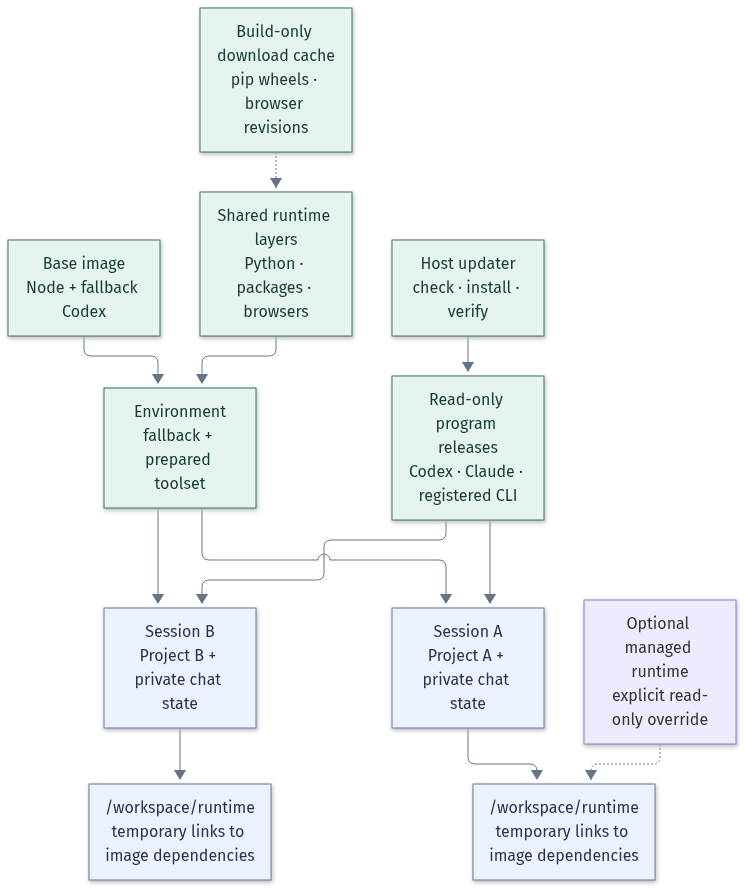

# Environments and shared runtimes

Use **one environment per toolset**, then reuse it across projects and chats.
For drawing work the normal launch needs only:

```sh
isolated-harness codex --workspace /path/to/project --environment drawing-review-v1
```

No separate runtime import or per-project dependency installation is required.

## The relationship

| Concept | Owns | Lifetime and sharing |
| --- | --- | --- |
| Base Codex image | Node and a fallback Codex CLI version | Local Docker image; initialized once and updated deliberately |
| Harness program release | The currently selected Codex/other CLI executable | Shared per harness/OS/CPU; automatically updated independently of the image |
| Runtime dependencies | Python, packages, system libraries and browser binaries | Immutable Docker layers shared on this machine |
| Environment | A named selection of Codex plus runtime dependencies | Built once, reusable by many projects and sessions |
| Container / session | The running process, temporary files, chat state | New container per launch; chat state stays scoped to its project/session |
| Managed runtime (`--runtime`) | A deliberately imported Linux Python/browser artifact | Optional advanced override, shared read-only by default |



The default environment build prepares dependency layers from
`node:22-bookworm-slim` independently of Codex, then copies Codex from the
selected base image **after** dependency installation. Updating Codex therefore
keeps the prepared Python and browser layers. A custom `baseImage` retains its
own filesystem and is rebuilt when that base changes; it does not use the
Codex-specific copying optimization.

`/workspace/runtime` is an **access path**, not another runtime download.
It is a tiny, disposable tmpfs containing links into the image:

- `venv` and `python` point to `/opt/isolated-harness/python`.
- `browsers` links to the binaries in `/opt/ms-playwright`.
- Playwright's writable `.links` registry belongs to the current container.

Every preset exposes this path. Docker may need an empty host `runtime/`
mountpoint while a session runs; the harness removes it on exit if it created
it and it is still empty. Existing project directories are preserved. No
dependency files are copied into that host directory. The generated session `AGENTS.md` describes the available dependencies
and tells the agent to reuse them. All presets' Python environments are also on
`PATH`.

## Prepare once

```sh
isolated-harness image build
isolated-harness environment prebuild drawing-review
isolated-harness environment verify drawing-review-v1
isolated-harness codex --workspace /path/to/project --environment drawing-review-v1
```

| Preset | Includes |
| --- | --- |
| `python-analysis` | Python, jsonschema, NumPy and SymPy |
| `document-review` | Python, Poppler, NSS, Pillow and PyMuPDF |
| `browser-review` | Python Playwright and Chromium |
| `drawing-review` | Document tools, numerical libraries, Playwright and Chromium |

`environment prebuild` with no names prepares all four. `environment list`
shows the selected image, actual base image ID, Codex version, platform,
dependency identity and whether the build reused a runtime.

## Automatic program upgrades

Normal sessions automatically check for stable harness releases on startup,
with a shared one-hour check cache. Long-running online sessions also
recheck hourly; existing processes keep running their original release. A program update installs only the selected
CLI and verifies it before switching the shared version. It does not rebuild
the environment or download its runtime. `codex update`, `harness-update`, and
registered npm global update commands work inside the container through a
private session request channel; the host performs the bounded installation.
The Docker socket, host history, and a writable shared program directory are
not exposed to sessions.

Verified releases live under
`~/.isolated-harness/harness-programs/<id>/<os>-<cpu>/releases/`. Public package
downloads have a separate cache. A short-lived installer container can write
only the staging release and download cache. Installations are serialized per
harness/platform, and previous releases remain available to running processes.
Pinned sessions select a fixed release without modifying the shared current
version. Offline sessions do not check or download updates. Registry or
installation failure during an automatic check falls back to the current
verified version; an explicitly requested failed update reports an error.

A session records the program version separately from the environment image's
baked-in Codex version. Read `harnessProgram` in interactive session metadata
or `harness.version` in batch receipts for the program selected at launch.
See [Quick Start](QUICKSTART.md#automatic-harness-upgrades) for commands and
other npm-distributed harnesses.

## Maintain the fallback base image

```sh
isolated-harness image update
```

This resolves the official npm `latest` tag to an exact version, builds and
checks the base image, then rebuilds **every registered environment using that
base**. New sessions use the updated environments. Running containers continue
with their original image. Unused presets are not downloaded automatically.

For a controlled upgrade or rollback:

```sh
isolated-harness image update --codex-version 0.165.0
```

`image build` updates only the base; `image update` also updates its registered
environments. Both accept an optional image tag. A bare `docker build` uses the
version pinned in the packaged Dockerfile; the harness commands resolve latest
unless an exact version is supplied. A literal `@latest` inside a cached Docker
installation step would not reliably update, which is why resolution happens
before the build.

Each environment records the actual base image ID. Changing `codex-cli:local`
therefore changes the environment's identity even though the tag stays the
same. Dependency identity excludes the environment name and Codex version.
Identical toolsets can reuse an existing local environment's dependency layers,
including legacy images. Dependency snapshots are recorded separately, so
repeated Codex updates do not stack another entire Codex installation in the
shared runtime. Legacy browser layouts are reconciled once with the
installed Playwright package; only missing browser revisions need downloading.

The new image must pass an offline probe before its environment record is
atomically replaced. The probe imports all declared Python modules, actually
launches and closes each declared browser, and checks the recorded Codex
version. A failed build or probe leaves the previous environment selected.

Environments built with an explicit CA file should be rebuilt from their
original `--spec` file; saved records intentionally retain only its basename.

## Exactly what is shared

| Operation | Reuse | Downloads |
| --- | --- | --- |
| Open another project/chat with the same environment | Existing local image, immutable dependencies and a shared harness program | None for the prepared runtime; a due program check may fetch a newer CLI |
| Run `prebuild` again with unchanged inputs | Existing verified image | None |
| Update the running harness program | Existing dependency layers; publish a new verified program release | New CLI package, if absent; no environment rebuild |
| Update the fallback base image | Existing dependency snapshots; replace the baked-in Codex payload | New Codex package, if absent |
| Build another environment with identical dependencies | Existing local runtime layers, independent of its name | None for those dependencies |
| Change the dependency set | Docker's matching layers plus pip/browser build caches | Missing packages and browser revisions; package index metadata may be fetched |
| Use a different machine or CPU platform | A separate compatible image is needed | First build/download on that machine |

BuildKit download caches live in Docker's builder storage. pip wheels and
Playwright browser revisions are reused across builds on the same OS and CPU
architecture; browser garbage
collection is disabled for this shared build cache. Cache mounts use
`sharing=locked` so simultaneous builds do not modify the same cache at once.
The browser cache may retain several revisions, and images copied from it may
include more than the current revision. These caches are for building images;
agent sessions never receive a shared writable package cache.

Sharing has limits: Linux/macOS binaries, CPU architectures, Python versions,
and Playwright/browser revisions must match. Different dependency sets do not
share a writable virtualenv. Changing a proxy CA updates the local trust layer
without reinstalling the toolset. Docker images do not share host credentials,
chat history or project files. Model requests and project-specific dependencies
can still require network access.

Unpinned dependencies are snapshots of a successful build, not automatically
refreshed on each launch. To deliberately upgrade tooling, change/pin package
versions in a spec and build it. Removing Docker's images/build cache causes a
later build to fetch missing data again.

## Environment specification

```json
{
  "version": "v1",
  "name": "drawing-review-v1",
  "baseImage": "codex-cli:local",
  "pythonVersion": "3.12",
  "packageMirror": "tuna",
  "apt": ["poppler-utils", "libnss3"],
  "pip": ["jsonschema", "pymupdf"],
  "playwright": ["chromium"]
}
```

```sh
isolated-harness environment build --spec examples/drawing-review.environment.json
```

Python/Playwright environments default to `workspaceRuntime: true`.
`pythonVersion: "3.12"` selects the official Python runtime. `packageMirror:
"tuna"` selects the Tsinghua Debian and PyPI mirrors; Debian security updates
stay on the official security repository. Browser selection adds the Python
Playwright package automatically. Pin package versions for controlled upgrades.
Safe package names and optional exact Python versions are accepted; shell
commands, package URLs and Dockerfile fragments are rejected.

Records are stored under `~/.isolated-harness/environments/`, or under
`ISOLATED_HARNESS_STATE_ROOT` if configured. Executable image layers and build
caches live in Docker storage, outside the project. Do not mount a host's agent
home to share a runtime.

## Reuse a runtime produced by a workspace

This is an advanced migration/override path, not a second required setup step:

```sh
isolated-harness runtime import --name drawing-runtime --source /path/to/old-project/runtime
isolated-harness codex --workspace /path/to/new-project \
  --environment drawing-review-v1 --runtime drawing-runtime
```

Imports live under `~/.isolated-harness/runtimes/<name>`. They preserve Linux
`python`, `venv`, `browsers` and optional helper directories. Mutable `cache/`
is omitted unless `--with-cache` is supplied. New imports hash file contents,
executable modes and symlink targets; same-size edits change the digest. An
identical reimport is idempotent; different content requires a new name so
existing projects keep their artifact. Existing manifests remain readable.

An explicitly selected managed runtime takes precedence for Python, `PATH`,
and browsers. It can therefore lack packages declared by the environment;
its compatibility is the owner's responsibility. Normal launches should omit
`--runtime` and use the environment's verified dependency set.

`--runtime-write` is retained for deliberate maintenance. It serializes
**writers only**; it does not exclude existing readers. A writable shared
runtime can affect other sessions, and its import digest is a snapshot, not
continuous integrity monitoring. Use a new named import for reproducible work.

`environment build --preset drawing-review --runtime-source <managed-directory>`
can seed browser downloads from an old artifact. Fresh builds copy only the
browser seed and prepare the declared Python packages; they do not copy an
entire second Python runtime. Legacy image reuse preserves existing layers
and disk size. It does not retroactively remove duplicated data from old
images.

## Reset and TLS

```sh
isolated-harness environment reset drawing-review-v1
isolated-harness environment build --preset drawing-review
```

Reset removes the selected environment tag and record without forcibly
interrupting running containers. Dependency snapshot tags and build caches may
still hold shared layers; reset is not a promise to reclaim all disk space.

For a private proxy CA, set `trustedCaFile` to an absolute PEM file in the spec.
Otherwise detected macOS proxy settings use the host's public trust bundle.
The local image records a content digest of the bundle and installs it into the
Linux trust store. Do not publish an image containing an organization-private
CA. `UV_SYSTEM_CERTS=true` makes uv use that store.
